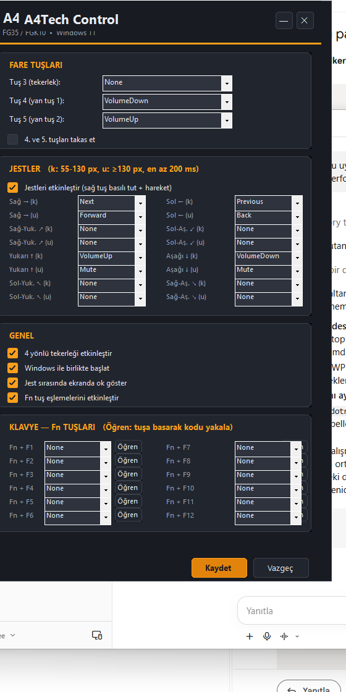
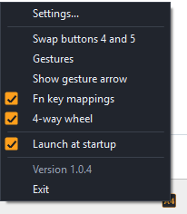

# A4Tech Control — FG35 / FGK10

A4Tech'in Windows 11'de sorun çıkaran 8-in-1 / 16-gesture yazılımının yerine geçen,
hafif ve yalnızca kullanıcı modunda çalışan alternatif.

## Görünüm

**Ayarlar penceresi**



**Tepsi menüsü**



## Neden?

- Orijinal sürücü (8-in-One V2023.1128) resmen **Windows 7/8/8.1/10** destekliyor; Windows 11'de çökme bilinen bir sonuç.
- FG35'in **DPI değişimi donanım anahtarıyla** yapılıyor (1200/1600/2000). Yani cihaza özel HID protokolüne gerek yok.
- FGK10 klavyesi plug-and-play; Fn kısayolları işletim sistemi tarafından zaten çalışıyor.
- Bu uygulama sadece fare olaylarını yeniden eşliyor: **kernel sürücüsü, imza, servis yok.**

## Özellikler

- Tuş 3 (tekerlek tıklaması), Tuş 4 ve Tuş 5 için eylem atama (ses aç/kapat, sessiz, medya, geri/ileri, sağ tık, orta tık veya özel kısayol)
- 4./5. tuş takası
- Sağ tuş basılı tutularak yapılan **16 jest**: 8 yön × 2 mesafe (kısa 55-130 px / uzun ≥130 px), her birine ayrı eylem
- Jest algılama en az 200 ms basılı tutma gerektirir; hızlı sağ tık her zaman menüyü açar (sağ tık bozulmaz)
- **Jest görsel geri bildirimi:** jest çizilirken ekranda turuncu ok, yön ve eylem adı (tıklamaları geçirir)
- **Klavye Fn+F1…F12 eşlemeleri:** "Öğren" düğmesiyle klavyenizin gönderdiği gerçek tuş kodu kaydedilir
- 4 yönlü tekerleği aç/kapat
- Windows ile birlikte başlatma
- Özel turuncu **"A4"** tepsi ikonu + açılış balon bildirimi (eski genel mavi "i" ikonu yerine)
- Koyu temalı, yuvarlatılmış kartlar ve turuncu vurgularla modern arayüz; standart Windows başlık çubuğu yerine özel başlık (sürüklenebilir, simge durumuna küçültme/kapatma)
- Sistem tepsisinden hızlı ayarlar
- Ayarlar `%AppData%\A4TechControl\settings.json` içinde saklanır
- Hatalar `%AppData%\A4TechControl\error.log` içine yazılır

## Derleme

Gereksinim: .NET 8 SDK (Windows).

```powershell
dotnet build -c Release
```

Çıktı: `bin\Release\net8.0-windows\A4TechControl.exe` (64-bit).

Tek dosyalık, bağımlılıksız dağıtım için:

```powershell
dotnet publish -c Release -r win-x64 --self-contained true `
  -p:PublishSingleFile=true -p:EnableCompressionInSingleFile=false `
  -p:IncludeNativeLibrariesForSelfExtract=false
```

## Kullanım

1. Orijinal A4Tech yazılımını kaldırın (Ayarlar → Uygulamalar).
2. Uygulamayı başlatın; tepsimede ikon görünür.
3. İkona çift tıklayarak ayarları açın, tuşları ve jestleri atayın.
4. "Açılışta başlat" seçeneğini işaretleyin.

> Not: Jest algılama sağ tuş basılıyken çalışır. Bir jest yapıldığında (en az 55 px hareket ve 200 ms)
> sağ tık menüsü bastırılır ve seçilen eylem çalıştırılır. Kısa bir sağ tık normal şekilde menüyü açar.

## Bellek

`EnableCompressionInSingleFile` kapalıyken özel bellek kullanımı yaklaşık **10 MB**'tır (eski A4Tech yazılımıyla aynı seviye). Sıkıştırma açıkken .NET assembly'leri çalışma anında bellege açıldığı için bu değer ~41 MB'a çıkıyordu; bu yüzden sıkıştırma kullanılmıyor. EXE tek dosya olsa da yanındaki birkaç doğal DLL (wpfgfx, D3DCompiler vb.) bulunmalıdır.

## Kurulum

En kolay yöntem: `Installer\Kurulum.bat` dosyasına çift tıkla. Admin yetkisi gerekmez.

- Kurulum yeri: `%LOCALAPPDATA%\Programs\A4TechControl`
- Başlat menüsüne kısayol eklenir
- Program Ekle/Kaldır listesine kayıt olur
- Kaldırmak için `Installer\Kaldir.bat` (ayarları korumak için varsayılan) veya `%LOCALAPPDATA%\Programs\A4TechControl\Uninstall.ps1`

Komut satırından:

```powershell
powershell -ExecutionPolicy Bypass -File .\Installer\Install.ps1
```

Profesyonel bir kurulum sihirbazı istersen `Installer\setup.iss` dosyası Inno Setup 6 için hazırdır (ISCC.exe ile derle; çıktı `SetupOutput\` klasörüne gider).

## Mimari

| Dosya | Görev |
|---|---|
| `NativeMethods.cs` | Win32 P/Invoke tanımları (hook, SendInput) |
| `MouseHook.cs` | `WH_MOUSE_LL` ile olay yakalama ve eşleme |
| `InputSender.cs` | Etiketli yapay klavye/fare olayları (döngü önleme) |
| `ActionDispatcher.cs` | Eylem adı → gerçek komut |
| `HotkeyParser.cs` | "Ctrl+Shift+A" → sanal tuşlar |
| `GestureRecognizer.cs` | 8 yönlü hareket tanıma |
| `AppSettings.cs` | JSON ayarlar |
| `SettingsForm.cs` | Ayarlar arayüzü |
| `TrayAppContext.cs` | Tepsi ikonu ve menü |
